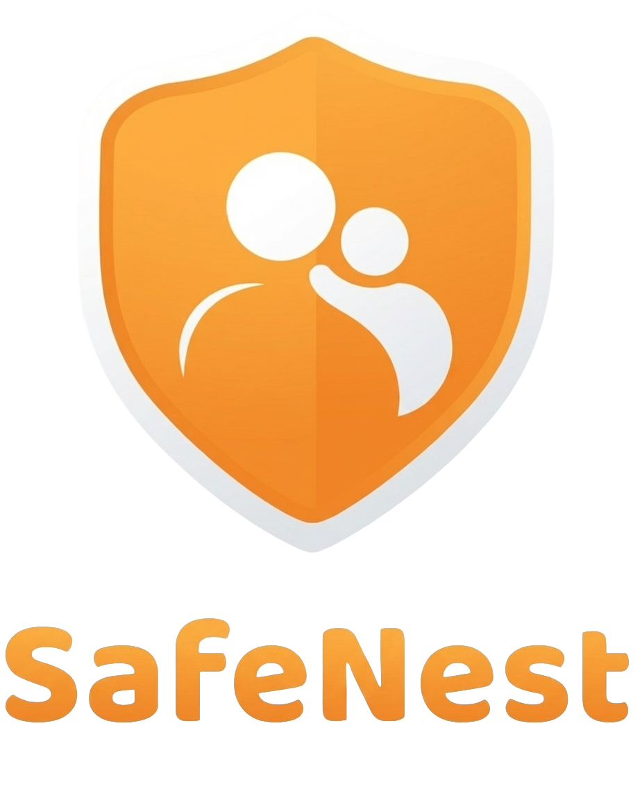

<p align="center">
  
</p>

<h1 align="center">Tuteliq React Native SDK</h1>

<p align="center">
  <strong>Official React Native SDK for the Tuteliq API</strong><br>
  AI-powered child safety analysis
</p>

<p align="center">
  <a href="https://www.npmjs.com/package/@tuteliq/react-native"></a>
  <a href="https://github.com/Tuteliq/react-native/actions"></a>
  <a href="https://github.com/Tuteliq/react-native/blob/main/LICENSE"></a>
</p>

<p align="center">
  <a href="https://docs.tuteliq.ai">API Docs</a> •
  <a href="https://tuteliq.ai">Dashboard</a> •
  <a href="https://trust.tuteliq.ai">Trust</a> •
  <a href="https://discord.gg/7kbTeRYRXD">Discord</a>
</p>

---

## Installation

```bash
npm install @tuteliq/react-native
# or
yarn add @tuteliq/react-native
```

### Requirements

- React Native 0.70+
- React 17+

This package wraps the [Tuteliq Node SDK](https://github.com/Tuteliq/node) (`@tuteliq/sdk`) in a provider and React hooks. Everything the Node SDK exports (the client, enums, errors, helpers and types) is re-exported from `@tuteliq/react-native`, so you never need to import `@tuteliq/sdk` directly.

---

## Quick Start

### Set up the provider

Wrap your app with `TuteliqProvider`:

```tsx
import React from 'react';
import { TuteliqProvider } from '@tuteliq/react-native';
import { ChatInput } from './ChatInput';

export default function App() {
  return (
    <TuteliqProvider apiKey="your-api-key">
      <ChatInput />
    </TuteliqProvider>
  );
}
```

### Use a hook

```tsx
import React, { useState } from 'react';
import { Alert, Button, TextInput, View } from 'react-native';
import { useAnalyze, isActionable } from '@tuteliq/react-native';

export function ChatInput() {
  const { execute, loading } = useAnalyze();
  const [message, setMessage] = useState('');

  const handleSend = async () => {
    const result = await execute({ content: message });

    if (isActionable(result.recommended_action)) {
      Alert.alert('Warning', result.summary);
      return;
    }

    // Send the message...
  };

  return (
    <View>
      <TextInput value={message} onChangeText={setMessage} />
      <Button title="Send" onPress={handleSend} disabled={loading} />
    </View>
  );
}
```

`recommended_action` (`none`, `monitor`, `flag_for_review`, `block` or `immediate_intervention`) is the field to branch on. `isActionable()` is true from `flag_for_review` upwards.

---

## API Reference

### Provider

```tsx
import React from 'react';
import { TuteliqProvider } from '@tuteliq/react-native';

export function Root({ children }: { children: React.ReactNode }) {
  return (
    <TuteliqProvider
      apiKey="your-api-key"
      options={{
        timeout: 30000, // Request timeout in ms
        retries: 3, // Retry attempts for failed requests
        retryDelay: 1000, // Initial retry delay in ms
      }}
    >
      {children}
    </TuteliqProvider>
  );
}
```

The client is created once, when the provider first renders.

### Hooks

Every request hook returns:

- `data`: the result (`null` until executed)
- `loading`: whether a request is in flight
- `error`: the last error, if any
- `execute(input)`: runs the request and resolves with the result (it also rethrows errors)
- `reset()`: clears `data` and `error`

| Area | Hooks |
|------|-------|
| Safety | `useDetectBullying`, `useDetectGrooming`, `useDetectUnsafe`, `useAnalyze`, `useAnalyzeEmotions`, `useDetectDistressSignals`, `useDetectTFGBV` |
| Fraud and harm | `useDetectSocialEngineering`, `useDetectAppFraud`, `useDetectRomanceScam`, `useDetectMuleRecruitment`, `useDetectGamblingHarm`, `useDetectCoerciveControl`, `useDetectVulnerabilityExploitation`, `useDetectRadicalisation` |
| Multi and batch | `useAnalyseMulti`, `useBatch` |
| Media | `useAnalyzeImage`, `useAnalyzeVoice`, `useAnalyzeVideo`, `useAnalyzeDocument`, `useVoiceStream` |
| Synthetic content | `useDetectSyntheticText`, `useDetectSyntheticImage`, `useDetectSyntheticAudio`, `useDetectSyntheticVideo` |
| Guidance and reports | `useGetActionPlan`, `useGenerateReport` |
| Verification | `useCreateVerificationSession`, `useGetVerificationSession`, `useCancelVerificationSession`, `useVerifyImageMatch` |
| Incidents | `useListIncidents`, `useGetIncident`, `useGetIncidentsOverview`, `useGetIncidentTrends`, `useReviewIncident`, `useBatchReviewIncidents` |
| Webhooks | `useListWebhooks`, `useCreateWebhook`, `useUpdateWebhook`, `useDeleteWebhook`, `useTestWebhook`, `useRegenerateWebhookSecret` |
| Usage and pricing | `useGetUsageSummary`, `useGetQuota`, `useGetUsageHistory`, `useGetUsageByTool`, `useGetUsageMonthly`, `useGetPricing`, `useGetPricingDetails` |
| Privacy (GDPR) | `useDeleteAccountData`, `useExportAccountData`, `useRecordConsent`, `useGetConsentStatus`, `useWithdrawConsent`, `useRectifyData`, `useGetAuditLogs`, `useLogBreach`, `useListBreaches`, `useGetBreach`, `useUpdateBreachStatus` |

Client methods without a hook (policy rules, detection settings, threat intelligence and others) are available through [`useTuteliqClient`](#direct-client-access).

#### useDetectBullying

```tsx
import { useDetectBullying } from '@tuteliq/react-native';

export function useBullyingCheck() {
  const { execute } = useDetectBullying();

  return async (content: string) => {
    const result = await execute({ content });
    if (result.is_bullying) {
      console.log('Severity:', result.severity);
      console.log('Types:', result.bullying_type);
    }
    return result;
  };
}
```

#### useDetectGrooming

Roles are plain strings: `'adult'`, `'child'` or `'unknown'`.

```tsx
import { useDetectGrooming } from '@tuteliq/react-native';

export function useGroomingCheck() {
  const { execute } = useDetectGrooming();

  return async () => {
    const result = await execute({
      messages: [
        { role: 'adult', content: 'This is our secret' },
        { role: 'child', content: 'Ok I wont tell' },
      ],
      childAge: 12,
    });

    console.log('Risk:', result.grooming_risk);
    console.log('Action:', result.recommended_action);

    // Per-message breakdown (omitted in verdictOnly mode)
    result.message_analysis?.forEach((m) => {
      console.log(`Message ${m.message_index}: risk=${m.risk_score}, flags=${m.flags}`);
    });
  };
}
```

#### useDetectUnsafe

```tsx
import { useDetectUnsafe } from '@tuteliq/react-native';

export function useUnsafeCheck() {
  const { execute } = useDetectUnsafe();

  return async (content: string) => {
    const result = await execute({ content });
    if (result.unsafe) {
      console.log('Categories:', result.categories);
    }
  };
}
```

#### useAnalyze

Quick analysis combining bullying and unsafe detection:

```tsx
import { useAnalyze } from '@tuteliq/react-native';

export function useQuickCheck() {
  const { execute } = useAnalyze();

  return async (content: string) => {
    const result = await execute({ content });
    console.log('Risk level:', result.risk_level);
    console.log('Risk score:', result.risk_score);
    console.log('Summary:', result.summary);
  };
}
```

#### Fraud, harm and other detections

`useDetectSocialEngineering`, `useDetectAppFraud`, `useDetectRomanceScam`, `useDetectMuleRecruitment`, `useDetectGamblingHarm`, `useDetectCoerciveControl`, `useDetectVulnerabilityExploitation`, `useDetectRadicalisation`, `useDetectDistressSignals` and `useDetectTFGBV` all take the same input and return the same result shape:

```tsx
import { useDetectDistressSignals } from '@tuteliq/react-native';

export function useDistressCheck() {
  const { execute } = useDetectDistressSignals();

  return async (content: string) => {
    const result = await execute({ content, context: { ageGroup: '13-15' } });
    if (result.detected) {
      console.log('Level:', result.level);
      console.log('Categories:', result.categories.map((c) => c.tag));
      console.log('Action:', result.recommended_action);
    }
  };
}
```

#### useAnalyzeEmotions

```tsx
import { useAnalyzeEmotions } from '@tuteliq/react-native';

export function useEmotionCheck() {
  const { execute } = useAnalyzeEmotions();

  return async () => {
    const result = await execute({ content: 'Im so stressed about everything' });
    console.log('Emotions:', result.dominant_emotions);
    console.log('Trend:', result.trend);
  };
}
```

#### useGetActionPlan

`audience` is `'child'`, `'parent'` or `'platform'`.

```tsx
import { useGetActionPlan } from '@tuteliq/react-native';

export function useActionPlan() {
  const { execute } = useGetActionPlan();

  return async () => {
    const plan = await execute({
      situation: 'Someone is spreading rumors about me',
      childAge: 12,
      audience: 'child',
      severity: 'medium',
    });
    console.log('Steps:', plan.steps);
  };
}
```

#### useGenerateReport

```tsx
import { useGenerateReport } from '@tuteliq/react-native';

export function useIncidentReport() {
  const { execute } = useGenerateReport();

  return async () => {
    const report = await execute({
      messages: [
        { sender: 'user1', content: 'Threatening message' },
        { sender: 'child', content: 'Please stop' },
      ],
      childAge: 14,
    });
    console.log('Summary:', report.summary);
    console.log('Next steps:', report.recommended_next_steps);
  };
}
```

#### useBatch

Analyze up to 50 items in one request:

```tsx
import { useBatch } from '@tuteliq/react-native';

export function useBatchCheck() {
  const { execute } = useBatch();

  return async () => {
    const result = await execute({
      items: [
        { type: 'bullying', content: 'first message', external_id: 'msg_1' },
        { type: 'unsafe', content: 'second message', external_id: 'msg_2' },
      ],
    });
    console.log('Succeeded:', result.summary.successful, 'Failed:', result.summary.failed);
  };
}
```

#### Synthetic content

```tsx
import { useDetectSyntheticText } from '@tuteliq/react-native';

export function useSyntheticTextCheck() {
  const { execute } = useDetectSyntheticText();

  return async (content: string) => {
    const result = await execute({ content });
    console.log('Classification:', result.classification);
    console.log('Confidence:', result.confidence);
  };
}
```

`useDetectSyntheticImage`, `useDetectSyntheticAudio` and `useDetectSyntheticVideo` take a `file` and a `filename` the same way.

### Verification

Age and identity verification is session based. You create a session, open its URL so the user can complete the flow (document capture, liveness and selfie) in the hosted web UI, then read the outcome from the session or from the `verification.completed` webhook.

```tsx
import React from 'react';
import { Button, Linking } from 'react-native';
import {
  useCreateVerificationSession,
  useGetVerificationSession,
  VerificationMode,
  VerificationSessionStatus,
} from '@tuteliq/react-native';

export function AgeGate() {
  const createSession = useCreateVerificationSession();
  const session = useGetVerificationSession();

  const start = async () => {
    const created = await createSession.execute({
      mode: VerificationMode.AGE,
      auto_capture: true, // Optional, default true
    });
    await Linking.openURL(created.url);
  };

  const check = async () => {
    if (!createSession.data) return;
    const status = await session.execute(createSession.data.session_id);

    if (status.status === VerificationSessionStatus.COMPLETED && status.result) {
      console.log('Decision:', status.result.status); // 'verified' | 'failed' | 'needs_review'
      console.log('Minor:', status.result.is_minor);
      console.log('Face match:', status.result.face_match?.match_score);
    }
  };

  return (
    <>
      <Button title="Verify my age" onPress={start} disabled={createSession.loading} />
      <Button title="Check result" onPress={check} disabled={session.loading} />
    </>
  );
}
```

- `mode` is `VerificationMode.AGE` or `VerificationMode.IDENTITY`.
- `chip_policy` (`ChipPolicy.OPTIONAL`, `REQUIRED` or `INSTEAD_OF_PHOTO`) sets how a passport or ID card chip read counts as document evidence.
- `auto_capture` sets whether the web UI takes the document photo itself once the document is framed, steady and sharp.
- Session `status` is one of `pending`, `in_progress`, `document_required`, `completed`, `failed` or `expired`. A cancelled session (`useCancelVerificationSession`) reads as `expired`.
- `face_match.match_score` (0 to 1) shows how strongly the selfie matches the document photo; `matched` is true above 0.5.
- The extracted document fields, `date_of_birth`, `failure_reasons` and `capture` are released once, on the first read after the session finishes. Store them then, or use the webhook.
- Session creation is never retried automatically, so a lost response cannot create a second session.

See the [verification docs](https://docs.tuteliq.ai) for plans and pricing.

### Incidents

```tsx
import { useListIncidents, useReviewIncident } from '@tuteliq/react-native';

export function useModerationQueue() {
  const incidents = useListIncidents();
  const review = useReviewIncident();

  const load = () => incidents.execute({ status: 'new', limit: 20 });

  const dismiss = (incidentId: string) =>
    review.execute({
      incidentId,
      input: {
        action: 'dismiss',
        reason_code: 'false_positive',
        moderator_external_id: 'moderator_42',
      },
    });

  return { incidents: incidents.data?.incidents ?? [], load, dismiss };
}
```

`useBatchReviewIncidents` applies one review to up to 100 incidents. `useGetIncidentsOverview` and `useGetIncidentTrends` return counts for dashboards.

### Voice Streaming

Real-time voice analysis with the `useVoiceStream` hook:

```tsx
import React from 'react';
import { Button } from 'react-native';
import { useVoiceStream } from '@tuteliq/react-native';

export function VoiceMonitor() {
  const { isConnected, start, stop } = useVoiceStream({
    config: { intervalSeconds: 10, analysisTypes: ['bullying', 'unsafe'] },
    handlers: {
      onReady: (e) => console.log('Session ready:', e.session_id),
      onTranscription: (e) => console.log('Text:', e.text),
      onAlert: (e) => console.log('Alert:', e.category, e.severity),
      onSessionSummary: (e) => console.log('Summary:', e.overall_risk),
    },
  });

  return (
    <Button
      title={isConnected ? 'Stop Monitoring' : 'Start Monitoring'}
      onPress={isConnected ? stop : start}
    />
  );
}
```

Send audio chunks with `sendAudio(data)` while connected.

### Direct Client Access

For anything without a hook, use the client directly:

```tsx
import { useTuteliqClient } from '@tuteliq/react-native';

export function usePolicyRules() {
  const { client } = useTuteliqClient();

  return async () => {
    const { rules } = await client.listPolicyRules();
    return rules;
  };
}
```

---

## Tracking Fields

Requests accept `external_id`, `customer_id` and `metadata` for correlation. They are echoed back in the response:

```tsx
import { useDetectBullying } from '@tuteliq/react-native';

export function useTrackedCheck() {
  const { execute } = useDetectBullying();

  return async () => {
    const result = await execute({
      content: 'Message to check',
      external_id: 'msg_12345',
      customer_id: 'cust_abc',
      metadata: { sessionId: 'sess_xyz' },
    });

    console.log(result.external_id); // "msg_12345"
    console.log(result.metadata); // { sessionId: "sess_xyz" }
  };
}
```

---

## Error Handling

```tsx
import React from 'react';
import { Text } from 'react-native';
import {
  useAnalyze,
  AuthenticationError,
  RateLimitError,
  ValidationError,
} from '@tuteliq/react-native';

export function CheckStatus() {
  const { execute, error } = useAnalyze();

  const handleCheck = async () => {
    try {
      await execute({ content: 'test' });
    } catch (err) {
      if (err instanceof AuthenticationError) {
        console.log('Invalid API key');
      } else if (err instanceof RateLimitError) {
        console.log('Too many requests');
      } else if (err instanceof ValidationError) {
        console.log('Invalid input:', err.details);
      }
    }
  };

  // Or use the error state
  if (error) {
    return <Text>Error: {error.message}</Text>;
  }

  return <Text onPress={handleCheck}>Check</Text>;
}
```

---

## Complete Example

```tsx
import React, { useState } from 'react';
import { View, TextInput, Button, Text, Alert, StyleSheet } from 'react-native';
import { TuteliqProvider, useAnalyze, isActionable } from '@tuteliq/react-native';

function ChatScreen() {
  const [message, setMessage] = useState('');
  const { execute, loading, data } = useAnalyze();

  const handleSend = async () => {
    if (!message.trim()) return;

    try {
      const result = await execute({ content: message });

      if (isActionable(result.recommended_action)) {
        Alert.alert('Message Blocked', result.summary, [
          { text: 'OK', onPress: () => setMessage('') },
        ]);
        return;
      }

      // Safe to send
      console.log('Sending message:', message);
      setMessage('');
    } catch {
      Alert.alert('Error', 'Failed to check message');
    }
  };

  return (
    <View style={styles.container}>
      <TextInput
        style={styles.input}
        value={message}
        onChangeText={setMessage}
        placeholder="Type a message..."
        editable={!loading}
      />
      <Button title={loading ? 'Checking...' : 'Send'} onPress={handleSend} disabled={loading} />
      {data && (
        <Text style={styles.status}>
          Last check: {data.risk_level} (score: {data.risk_score.toFixed(2)})
        </Text>
      )}
    </View>
  );
}

export default function App() {
  return (
    <TuteliqProvider apiKey="your-api-key">
      <ChatScreen />
    </TuteliqProvider>
  );
}

const styles = StyleSheet.create({
  container: { flex: 1, padding: 20, justifyContent: 'flex-end' },
  input: { borderWidth: 1, borderColor: '#ccc', padding: 10, marginBottom: 10, borderRadius: 8 },
  status: { marginTop: 10, color: '#666', fontSize: 12 },
});
```

---

## Best Practices

### Message Batching

The **bullying** and **unsafe content** methods analyze a single `content` string per request. If your app receives messages one at a time, join a **sliding window of recent messages** into one string before calling the API. Single words or short fragments lack the context needed for accurate detection.

```tsx
import { useDetectBullying } from '@tuteliq/react-native';

export function useWindowedCheck(recentMessages: string[]) {
  const { execute } = useDetectBullying();

  // Recent messages analyzed together, not one at a time
  return () => execute({ content: recentMessages.slice(-10).join(' ') });
}
```

The **grooming** method already accepts a `messages[]` array and analyzes the full conversation in context.

---

## Supported Languages

Tuteliq supports **32 languages** with automatic detection, no configuration required.

**English** (stable) and **31 beta languages**: Spanish, Portuguese, Ukrainian, Swedish, Norwegian, Danish, Finnish, German, French, Dutch, Polish, Italian, Turkish, Romanian, Greek, Czech, Hungarian, Bulgarian, Croatian, Slovak, Lithuanian, Latvian, Estonian, Slovenian, Maltese, Irish, Chinese, Japanese, Korean, Arabic and Russian.

All 24 EU official languages, plus Ukrainian, Norwegian, Turkish, Chinese, Japanese, Korean, Arabic and Russian. Each language includes culture-specific safety guidelines covering local slang, grooming patterns and self-harm coded vocabulary.

See the [Language Support docs](https://docs.tuteliq.ai/languages) for details.

---

## Support

- **API Docs**: [docs.tuteliq.ai](https://docs.tuteliq.ai)
- **Discord**: [discord.gg/7kbTeRYRXD](https://discord.gg/7kbTeRYRXD)
- **Email**: support@tuteliq.ai
- **Issues**: [GitHub Issues](https://github.com/Tuteliq/react-native/issues)

---

## License

MIT License - see [LICENSE](LICENSE) for details.

---

## Get Certified for Free

Tuteliq offers a **free certification program** for anyone who wants to deepen their understanding of online child safety. Complete a track, pass the quiz, and earn your official Tuteliq certificate, verified and shareable.

**Three tracks available:**

| Track | Who it's for | Duration |
|-------|-------------|----------|
| **Parents & Caregivers** | Parents, guardians, grandparents, teachers, coaches | ~90 min |
| **Young People (10–16)** | Young people who want to learn to spot manipulation | ~60 min |
| **Companies & Platforms** | Product managers, trust & safety teams, CTOs, compliance officers | ~120 min |

**Start here →** [tuteliq.ai/certify](https://tuteliq.ai/certify)

- 100% Free, no login required
- Verifiable certificate on completion
- Covers grooming recognition, sextortion, cyberbullying, regulatory obligations (KOSA, EU DSA), and more

---

## The Mission: Why This Matters

Before you decide to contribute or sponsor, read these numbers. They are not projections. They are not estimates from a pitch deck. They are verified statistics from the University of Edinburgh, UNICEF, NCMEC, and Interpol.

- **302 million** children are victims of online sexual exploitation and abuse every year. That is **10 children every second**. *(Childlight / University of Edinburgh, 2024)*
- **1 in 8** children globally have been victims of non-consensual sexual imagery in the past year. *(Childlight, 2024)*
- **370 million** girls and women alive today experienced rape or sexual assault in childhood. An estimated **240–310 million** boys and men experienced the same. *(UNICEF, 2024)*
- **29.2 million** incidents of suspected child sexual exploitation were reported to NCMEC's CyberTipline in 2024 alone, containing **62.9 million files** (images, videos). *(NCMEC, 2025)*
- **546,000** reports of online enticement (adults grooming children) in 2024, a **192% increase** from the year before. *(NCMEC, 2025)*
- **1,325% increase** in AI-generated child sexual abuse material reports between 2023 and 2024. The technology that should protect children is being weaponized against them. *(NCMEC, 2025)*
- **100 sextortion reports per day** to NCMEC. Since 2021, at least **36 teenage boys** have taken their own lives because they were victimized by sextortion. *(NCMEC, 2025)*
- **84%** of reports resolve outside the United States. This is not an American problem. This is a **global emergency**. *(NCMEC, 2025)*

End-to-end encryption is making platforms blind. In 2024, platforms reported **7 million fewer incidents** than the year before, not because abuse stopped, but because they can no longer see it. The tools that catch known images are failing. The systems that rely on human moderators are overwhelmed. The technology to detect behavior (grooming patterns, escalation, manipulation) in real-time text conversations **exists right now**. It is running at [api.tuteliq.ai](https://api.tuteliq.ai).

The question is not whether this technology is possible. The question is whether we build the company to put it everywhere it needs to be.

**Every second we wait, another child is harmed.**

We have the technology. We need the support.

If this mission matters to you, consider [sponsoring our open-source work](https://github.com/sponsors/Tuteliq) so we can keep building the tools that protect children, and keep them free and accessible for everyone.

---

<p align="center">
  <sub>Built with care for child safety by the <a href="https://tuteliq.ai">Tuteliq</a> team</sub>
</p>
